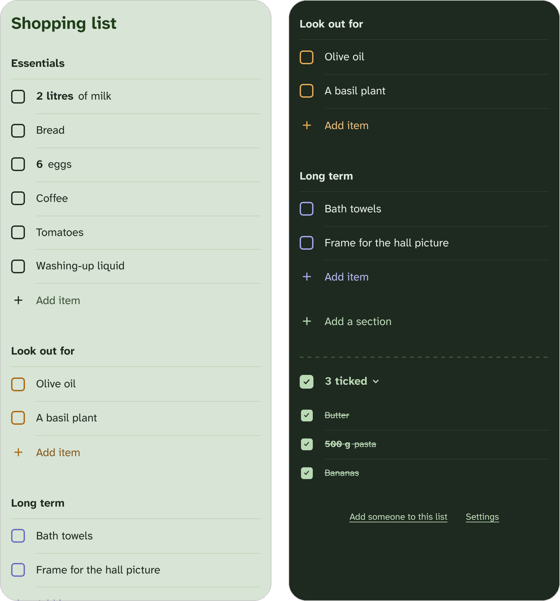

# Panier

A shopping list shared between two phones, end-to-end encrypted, with no accounts. It runs on Cloudflare's free plan or on a Raspberry Pi at home.

<p align="center"></p>

## What it is

- **Shared.** Two people, each on their own phone. Changes show on the other phone within a second.
- **Private.** The list is encrypted on the phones. The server stores it without being able to read it.
- **No accounts.** The second phone joins by scanning a QR code from the first.
- **Offline.** It works without signal and catches up when the connection returns.
- **An app from the browser.** It installs from Firefox, Chrome or Safari, with no app store.
- **Made for shopping.** Coloured sections, quantities such as *500 g flour*, suggestions from what you bought before, the last five days of ticked items, drag to reorder, and undo for everything.
- **In English and French**, light and dark.

## What it isn't, yet

- **One list, two people.** A phone holds one list. Several lists and more people are planned.
- **No recovery.** Without accounts there is no password reset. The pairing link is the key: lose every phone and every copy of the link, and the list is gone.
- **No backups** on the server yet. *Export the list*, in Settings, saves a text copy.
- **Not a hosted service.** You run your own server (see [Getting started](#getting-started)).

## Privacy in short

The server sees encrypted changes, when they're made, roughly how big they are, and the internet address they come from. It never sees item names, sections, or anything you type. It does deliver the app itself, so whoever controls the server could change the app: on Cloudflare, that means Cloudflare, and anyone who gets into your Cloudflare or GitHub account. [SECURITY.md](SECURITY.md) explains what Panier protects and what it doesn't, and how to report a problem.

## Getting started

First a server, then the two phones.

| | Cloudflare | Raspberry Pi |
| --- | --- | --- |
| You need | a GitHub account and a free Cloudflare account | a Pi 3 or newer, a domain name, and a home connection with its own IPv4 address and a router you can open ports on |
| Cost | free | the Pi and the domain |
| Upkeep | none | a small computer at home, always on |
| Address | `panier.<subdomain>.workers.dev`, or your own domain | your own domain |
| Updates | automatic: every change to `main`, once the tests pass | run the install script again; it fetches the latest release, which is published by hand, so it can lag behind `main` |
| Who could change the app | Cloudflare, and anyone in your Cloudflare or GitHub account | anyone with access to your Pi, or to this project's releases |
| Time to set up | about 20 minutes | about an hour |
| Guide | [docs/cloudflare.md](docs/cloudflare.md) | [docs/raspberry-pi.md](docs/raspberry-pi.md) |

Then, on the phones:

1. On the first phone, open the setup link from the guide. It creates the list.
2. On the second phone, scan the QR code that *Add someone to this list* shows.
3. Install the app on each phone: in Firefox, **⋮ → Install**; in Chrome, **⋮ → Install app**; on an iPhone, Safari's **Share → Add to Home Screen**.
4. Save the pairing link in a password manager.

## Using it

- **Add:** tap *Add item* at the end of a section and type. Enter adds the item and keeps the field open for the next.
- **Tick:** tap the square. Ticked items move to the ticked group after a moment, and stay there for five days.
- **Edit:** tap the words. Clear them to delete the item.
- **Move:** hold an item, or a section's name, for half a second, then drag.
- **Sections:** tap a section's name to rename it or change its colour. *Add a section* is below the last one.
- **The list:** tap its name to rename it or tint the paper.
- **Undo and redo:** the buttons at the bottom right.
- **Settings**, at the bottom of the list: light or dark, a compact layout, and exporting the list.

[docs/using.md](docs/using.md) has everything else: quantities, suggestions, keyboard shortcuts, what each gesture does exactly.

## Good to know

- **Browsers:** Firefox 121, Chrome 123, Safari 17.5 or later.
- **Where the list lives:** in the browser's storage on each phone, and encrypted on the server. If a phone's browser data is cleared, the pairing link brings the list back. Panier asks the browser to keep the list even when space runs low; Settings shows whether it agreed.
- **How long things stay:** ticked items show for five days, then are only suggested. Deleted items are forgotten after about six months.
- **Size:** the server keeps up to 32 MB per list, about 88,000 changes: many years of weekly shopping for two. A full list says *List full* and keeps new changes on the phone.
- **Updates** download in the background when the app opens. It then reloads into the new version, waiting until you're not typing, editing or dragging.
- **Vibration** when ticking works in Chrome and Samsung Internet on Android. Firefox and Safari don't let web pages vibrate.
- **On Android**, Chrome colours the navigation bar from a single colour in the app's manifest, so it stays dark in light mode. Android's themed icons aren't used for web apps yet, though Panier has one ready.

## How it works

- **The app** is plain HTML, CSS and JavaScript, with no framework and no build step. A service worker keeps it working offline. The font is Atkinson Hyperlegible Next, which keeps letters such as I, l and 1 apart.
- **One key per list.** The first phone makes a random 256-bit key. Each phone derives from it the list's id, an access token and an AES-GCM encryption key. The pairing link carries the key after `#`, a part of the address browsers never send to servers.
- **Changes.** Each change is encrypted on the phone, padded to 256 bytes so its size doesn't give away a name's length, and sent to the server. The server keeps them in order and pushes new ones to the other phone over a WebSocket.
- **Merging.** Each field, such as an item's name, section, position or tick, keeps its latest write. Both phones can edit offline and end up with the same list. Undo only reverses what the other phone hasn't changed since.
- **Two servers**, with the same API and the same tests:
  - **Cloudflare Workers**: a Durable Object with its own SQLite database per list, asleep between changes.
  - **Go**: one program using only the standard library, with a file per list, and the app built in.

| Folder | What's in it |
| --- | --- |
| [`web/`](web/) | the app: `app.js` for the screen, `store.js` for storage, encryption and sync, `i18n.js` for the words |
| [`worker/`](worker/) | the Cloudflare server |
| `*.go` | the Go server |
| [`deploy/install.sh`](deploy/install.sh) | the Raspberry Pi installer |
| [`test/`](test/) | tests of the API, the app in a browser, and updating |
| [`docs/`](docs/) | the setup guides and the full user guide |
| [`.github/workflows/ci.yml`](.github/workflows/ci.yml) | tests, deploy and release builds |

## Development

With Go 1.22 or later:

```sh
go run . -data ./data              # serves http://127.0.0.1:8080
go run . -data ./data -setup-code  # prints the setup code
```

Then open `http://127.0.0.1:8080/#setup=<code>`. Phones need HTTPS or `localhost`; with USB debugging, `adb reverse tcp:8080 tcp:8080` lets an Android phone open `http://localhost:8080`. The Cloudflare server runs locally with `npx wrangler dev --var SETUP_CODE:<code>`.

Tests run against either server. The browser tests need Playwright (`npm install --no-save playwright`, then `npx playwright install chromium`).

```sh
go test ./...
BASE=http://127.0.0.1:8080 SETUP=<code> node --test test/api.test.mjs
BASE=http://127.0.0.1:8080 SETUP=<code> STORE=./data node --test test/browser.test.mjs
```

`BROWSER=firefox` runs the browser tests in Firefox, and `LAYOUT=compact` in the compact layout. [`test/update.test.mjs`](test/update.test.mjs) explains how to run the update test.

On every push to `main` and every pull request, GitHub runs the Go tests, the update test, and the API and browser tests on both servers in Chromium, and on the Go server in Firefox. When they pass on `main`, it deploys to Cloudflare. Publishing a release (tag `v…`) builds the Go server for the Raspberry Pi (`arm64`, `armv7`, `armv6`) and `amd64`, with checksums.

## Next

Bigger features change how lists are stored and shared, so each starts with a short design note, agreed before building:

- encrypted backups kept on the server;
- more people, and several lists, each shared with different people;
- removing a person or phone from a list, by changing its key;
- recurring lists or sections, such as a weekly shop;
- sub-sections, such as fruit and vegetables, or cleaning;
- folding a section;
- compacting the server's log of changes.

## Licence

[MIT](LICENSE). The font is under the SIL Open Font License ([`web/fonts/OFL.txt`](web/fonts/OFL.txt)).
